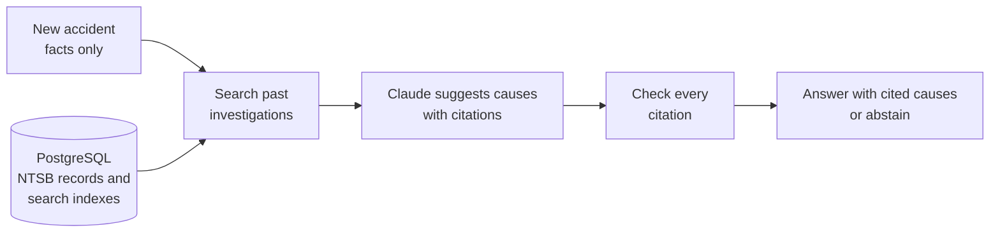

# CauseTrace

[](https://github.com/mihir1708/cause-trace/actions/workflows/ci.yml)
[](LICENSE)


**An AI system that suggests the likely causes of an aviation accident, backs each one with
a citation to a similar past investigation, and is tested honestly on accidents it has never
seen.**

When a plane crashes in the US, the National Transportation Safety Board (NTSB)
investigates and publishes official findings, often months or years later. CauseTrace reads
only the facts of a new accident (what happened, the aircraft, the weather) and:

1. searches the earlier NTSB investigations in the public database for similar accidents,
2. asks Claude to suggest likely causes from the NTSB's list of findings, each with a
   citation,
3. checks every citation and keeps only the causes the evidence supports, or says it does
   not know.

The suggestions are then compared with what the NTSB actually concluded, for every
qualifying accident from 2024 onward.

## Key findings

<!-- results:findings -->
- **Search finds relevant precedent.** For a new accident, the 10 most similar earlier investigations found by the search already contain 74% of its official causes on average (514 accidents from 2024 onward).
- **A simple baseline is hard to beat.** The best accuracy (F1 0.35) comes from `knn_vote`, a vote of the 10 most similar past accidents with no AI, ahead of the best Claude setup (F1 0.32). The project reports this rather than hiding it.
- **Retrieval makes the answers checkable.** With the most similar past reports, 47% of Claude's citations point to a report with the same cause, against 16% when given random reports.
- **Citations hold up to a manual check.** Of 50 sampled citations, 74% fully support the predicted cause and 94% support it at least partly.
- **Cheap to run.** Running all 4 Claude setups on the 514 test accidents cost $3.95 in API calls.
- **Stable under load.** The search API answered every request (0 errors) with up to 50 simultaneous users, peaking at 7.1 requests per second on one laptop process.
<!-- /results:findings -->

## How it works



- **Search.** Every past report is split into passages and indexed two ways: by meaning
  (vector embeddings) and by keywords (full-text search). The two rankings are combined.
- **Reasoning.** A small agent (LangGraph) plans searches, can look once more for missing
  evidence, proposes causes, and a separate step verifies that each cited report really
  supports the cause. Every step has a hard limit, so cost and time stay predictable.
- **Serving.** A FastAPI service exposes search and analysis, stores every run with a full
  trace, and fails cleanly (for example, it answers "try again later" instead of hanging
  when the AI provider times out).

## Example output

<!-- results:example -->
NTSB case `20240103193598` (the first 2024+ case, in ID order, with two or more cited findings; not selected for being correct). Each suggested cause comes with the earlier investigation it relies on:

| Suggested cause | Confidence | Why (Claude's rationale) | Cited earlier report | Also an NTSB finding? |
|---|---|---|---|---|
| Engine fuel and control | 0.50 | The airplane was idle for 26 months and the pilot could not verify fuel quality (possibly 2+ years old), and the loss of power is consistent with fuel-related causes such as stale fuel or fuel exhaustion in prior accidents. | `20200803X35353` | No |
| Ignition system | 0.40 | The right magneto would not produce spark when hand-rotated and was disassembled without findings, so an ignition system malfunction is a plausible cause of the power loss, as in prior magneto-related power losses. | `20201013102138` | No |

What the NTSB concluded for this case: Not determined-Not determined-(general)-(general)-Unknown/Not determined. 0 of 2 suggested causes match it.
<!-- /results:example -->

## Results

### Finding similar past investigations

<!-- results:retrieval -->
| Search method | Causes found in top 10 ¹ | Right report in top 10 ² |
|---|---|---|
| Meaning-based search (embeddings) | 68.2% | 68.9% |
| Keyword search (PostgreSQL full-text) | 73.8% | 42.1% |
| Both combined (reciprocal rank fusion) | 74.0% | 73.7% |
| Both combined, then reranked by a cross-encoder | 67.6% | 79.5% |

¹ Share of a new accident's official causes that appear in the 10 earlier investigations returned (514 accidents from 2024 onward). ² Share of 190 reviewed test questions whose source report is in the top 10. Full metrics: [`artifacts/retrieval_results.md`](artifacts/retrieval_results.md).
<!-- /results:retrieval -->

### Suggesting causes

<!-- results:causal -->
| System | What it is | Precision | Recall | F1 | Supported citations | Cost per case |
|---|---|---|---|---|---|---|
| `frequency_prior` | Always guesses the most common causes (no AI) | 0.29 | 0.25 | 0.27 | - | $0.0000 |
| `knn_vote` | Vote of the 10 most similar past accidents (no AI) | 0.28 | 0.45 | 0.35 | - | $0.0000 |
| `closed_book` | Claude with the accident facts only | 0.34 | 0.30 | 0.32 | - | $0.0005 |
| `random_context` | Claude with 10 random past reports (control) | 0.32 | 0.24 | 0.27 | 16% | $0.0009 |
| `rag` | Claude with the most similar past reports | 0.36 | 0.29 | 0.32 | 47% | $0.0019 |
| `rag_verify` | Same, plus a step that checks every citation | 0.37 | 0.23 | 0.29 | 55% | $0.0045 |

514 accidents from 2024 onward, never seen during development. *Precision*: share of suggested causes that the NTSB also found. *Recall*: share of the NTSB's causes that were suggested. *F1*: the balance of the two. *Supported citations*: share of citations whose earlier report has the same cause. Claude runs are `claude-haiku-5-5`, with confidence thresholds tuned on 2023 accidents only. Full metrics: [`artifacts/causal_results.md`](artifacts/causal_results.md).

Manual citation check: 50 of 50 sampled citations graded (proposed by Claude, reviewed and approved by Mihir Mukhi): 74.0% fully support the cause, 94.0% at least partly. The automatic verifier accepted 42.4% of the citations it checked.
<!-- /results:causal -->

### Load test

Measured on an Apple M5 Pro laptop with 24 GB of memory, with the API, the database and
the load generator on the same machine.

<!-- results:load -->
| Simultaneous users | Requests per second | Median response | 95th percentile | Errors |
|---|---|---|---|---|
| 1 | 1.0 | 0.7 s | 1.0 s | 0.0% |
| 10 | 6.3 | 1.2 s | 1.9 s | 0.0% |
| 25 | 7.1 | 3.1 s | 3.9 s | 0.0% |
| 50 | 6.5 | 7.1 s | 8.0 s | 0.0% |

POST /v1/search, 60s per level. Full report: [`artifacts/load_results.md`](artifacts/load_results.md).
<!-- /results:load -->

Throughput levels off as users are added while response times rise: one API process runs
the search models one request at a time, so extra users wait in line. More API
processes or a dedicated model server would raise the ceiling.

All tables and numbers in the sections above are generated from the files in
[`artifacts/`](artifacts) by `scripts/render_readme.py`, and a test fails if they fall out
of date.

## How the evaluation stays honest

The main risk in a project like this is accidentally showing the AI the answer.

- **Split by date.** Accidents from 2024 onward are held out. Nothing is tuned on them, and
  searches only ever return investigations dated before the accident being analysed.
- **Facts only.** The AI never sees the NTSB's conclusions for the accident it analyses;
  even the factual narrative is filtered to remove sentences copied from the conclusions.
  Automated tests check this.
- **Fair comparisons.** Claude is compared with simple non-AI baselines and with a control
  that gives it random reports instead of similar ones, so any gain has to be earned.
- **Numbers come from code.** Every reported number is produced by a script from the data.

Details: [`docs/DATA_LEAKAGE.md`](docs/DATA_LEAKAGE.md),
[`docs/EVAL_PROTOCOL.md`](docs/EVAL_PROTOCOL.md), and the design trade-offs in
[`docs/DECISIONS.md`](docs/DECISIONS.md).

## Built with

Python 3.12 · PostgreSQL 16 with pgvector (vector search) and full-text search ·
sentence-transformers (embeddings and reranking) · Claude API (`claude-haiku-5-5`) ·
LangGraph · FastAPI · OpenTelemetry · Locust · Docker · pytest, mypy and ruff in GitHub
Actions CI

## Run it

```sh
cp .env.example .env                 # add ANTHROPIC_API_KEY; MAX_USD caps spending
uv sync --group ml
make up                              # PostgreSQL in Docker
make ingest DATA=data/fixtures       # small sample of NTSB records included in the repo
make models && make index            # download the search models, build the indexes
make serve                           # API on http://127.0.0.1:8000 (interactive docs at /docs)
make check                           # lint, type checks, tests
```

The full results use the complete NTSB database
([download](https://data.ntsb.gov/avdata/FileDirectory/DownloadFile?fileID=C%3A%5Cavdata%5Cavall.zip)).
API endpoints, the command-line tool, evaluation commands and project rules are in
[`docs/DEVELOPMENT.md`](docs/DEVELOPMENT.md).

## Limitations

- **One model, one run.** The AI results come from a single run of `claude-haiku-5-5`;
  larger models and repeated runs were not compared.
- **The model may have read old reports.** Claude may have seen pre-2024 NTSB reports
  during training, which could flatter the setup that gets no search results.
- **Search improves grounding more than accuracy.** The simple nearest-neighbour vote has
  the best F1; what search adds to Claude is citations that actually support its answers.
- **The manual citation check is not independent.** The grades were proposed by Claude and
  reviewed and approved by the author.
- **NTSB findings are official conclusions,** not certain ground truth.
- **Not for real safety decisions.** This is a research and engineering project.

## Author

Mihir Mukhi. Released under the [MIT License](LICENSE).
