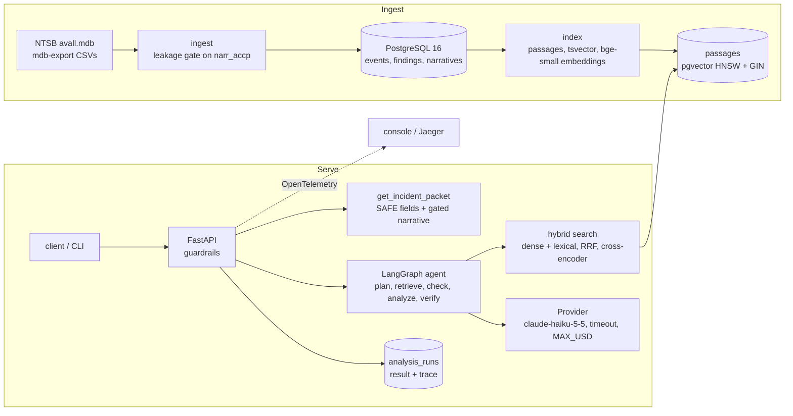

# CauseTrace

CauseTrace predicts the NTSB causal findings of an aviation accident from its facts. Given
an incident packet (date, place, weather, aircraft, injuries and the factual narrative), it
retrieves earlier investigations, has Claude propose findings from the NTSB taxonomy with
citations to those earlier reports, checks every citation, and answers or abstains. It is
served as an HTTP API with tracing, failure handling and guardrails, and evaluated against
simpler baselines on incidents from 2024 onward that it never saw.

Leakage control is the core requirement: see [`docs/DATA_LEAKAGE.md`](docs/DATA_LEAKAGE.md)
and [`docs/EVAL_PROTOCOL.md`](docs/EVAL_PROTOCOL.md). Design choices are in
[`docs/DECISIONS.md`](docs/DECISIONS.md); contributor rules in [`CLAUDE.md`](CLAUDE.md).

## Architecture



## Leakage controls

- **Split by date.** Held-out = `ev_date >= 2024-01-01`; nothing is tuned on held-out
  events. Every search is capped at the case's own cutoff (`corpus_cutoff`), so only earlier
  investigations can be retrieved, and the target event is excluded in SQL.
- **Model input is the packet only.** `causetrace.packets.get_incident_packet` selects an
  allowlist of SAFE fields and the factual narrative after a gate that removes sentences
  shared with the probable cause or analysis. The target's findings, probable cause and
  analysis never enter model input; `causetrace.gold` is read only for scoring. Tests check
  the packet builder, the agent and the API source for this.
- **History-only statistics.** The label taxonomy, lexical term weights, label frequencies
  and every tuned cut-off come from history events (cut-offs from 2023 dev events).
- **The API never returns gold labels.** Responses hold predictions, cited history passage
  ids and run metadata; stored runs hold the same.

## Local setup

Requires Python 3.12, [uv](https://docs.astral.sh/uv/) and Docker.

```sh
cp .env.example .env               # ANTHROPIC_API_KEY for the agent; MAX_USD caps spend
uv sync --group ml                 # app + sentence-transformers/torch for retrieval
make up                            # PostgreSQL 16 + pgvector
make ingest DATA=data/fixtures     # 300-event fixture (or the full export in data/raw/)
make models                        # download the embedding and reranking models
make index                         # passages + embeddings; resumes if interrupted
make check                         # ruff, mypy, pytest
```

For the full dataset, export the `events`, `aircraft`, `narratives` and `Findings` tables of
`avall.mdb` with `mdb-export` into `data/raw/` and run `make ingest`.

### API

```sh
make serve                         # uvicorn on http://127.0.0.1:8000 (or: make api, in Docker)
curl -s localhost:8000/health
curl -s localhost:8000/v1/search -H 'content-type: application/json' \
  -d '{"query": "engine lost power after takeoff", "before_date": "2024-01-01", "top_k": 5}'
curl -s localhost:8000/v1/analyze -H 'content-type: application/json' -d '{"ev_id": "<ev_id>"}'
curl -s localhost:8000/v1/runs/<run_id>
```

- `POST /v1/search`: hybrid search over history passages (`mode`: dense, lexical, rrf,
  rrf_rerank). If the reranker fails, the response uses rrf and says so in `fallback`.
- `POST /v1/analyze`: the agent on a stored event (`ev_id`) or a free-text `packet`. Packets
  are length-capped and checked for prompt injection (400). Findings without a valid
  citation are dropped; `grounding_score` is the share kept. An LLM timeout, overload or
  missing key returns 503; invalid model JSON is retried once, then the run abstains.
- `GET /v1/runs/{id}`: the stored run with its full node trace. `GET /health`: 503 when the
  database is down.

Interactive docs at `/docs`. Traces go to the console by default; for Jaeger run
`docker compose --profile api --profile tracing up -d` with `CAUSETRACE_TRACING=otlp` and
open http://localhost:16686.

### CLI

```sh
uv run --group ml causetrace ask <ev_id>          # agent answer with citations and trace
uv run --group ml causetrace eval retrieval       # = scripts/eval_retrieval.py
uv run --group ml causetrace eval causal -- --report-only   # = scripts/eval_causal.py (paid)
```

### Evaluations

```sh
make eval-retrieval                # artifacts/retrieval_results.{json,md}
make eval-causal-dev               # tune LLM cut-offs on 2023 events (paid)
make eval-causal                   # six systems on held-out events (paid, resumable)
uv run python scripts/grade_citations.py          # grade the 50 sampled citations
make loadtest                      # /v1/search at 1, 10, 25, 50 users (API must be running)
make readme                        # regenerate the tables below from artifacts/
```

## Results

Tables below are generated from `artifacts/` by `scripts/render_readme.py`; do not edit
them by hand.

### Retrieval

<!-- results:retrieval -->
From `artifacts/retrieval_results.json` (git `89a90683940d`): 121499 passages from 26804 history events; top 10 distinct events per query.

Held-out incidents (N = 514, query = the incident packet):

| Mode | Label Recall@10 | nDCG@10 | MRR | Hit@10 | p50 ms | p95 ms |
|---|---|---|---|---|---|---|
| dense | 0.682 | 0.171 | 0.257 | 0.529 | 20 | 24 |
| lexical | 0.738 | 0.200 | 0.281 | 0.560 | 1264 | 1737 |
| rrf | 0.740 | 0.194 | 0.285 | 0.572 | 1300 | 1735 |
| rrf_rerank | 0.676 | 0.155 | 0.240 | 0.529 | 1515 | 1939 |

Reviewed known-item questions (N = 190):

| Mode | Recall@10 | MRR | p95 ms |
|---|---|---|---|
| dense | 0.689 | 0.566 | 30 |
| lexical | 0.421 | 0.208 | 1029 |
| rrf | 0.737 | 0.520 | 1076 |
| rrf_rerank | 0.795 | 0.716 | 1319 |
<!-- /results:retrieval -->

### Causal findings

<!-- results:causal -->
From `artifacts/causal_results.json` (git `ea6726d2b5ea`): 514 of 514 scored held-out events; LLM systems use claude-haiku-5-5 with confidence cut-offs tuned on 2023 dev events; LLM cost $3.95.

| System | Cut-off | Micro P | Micro R | Micro F1 | F1 answered | Abstain | Cit. support | $ / case |
|---|---|---|---|---|---|---|---|---|
| frequency_prior | - | 0.295 | 0.246 | 0.268 | 0.268 | 0.000 | - | 0.0000 |
| knn_vote | - | 0.281 | 0.453 | 0.347 | 0.347 | 0.000 | - | 0.0000 |
| closed_book | 0.40 | 0.344 | 0.300 | 0.320 | 0.329 | 0.064 | - | 0.0005 |
| random_context | 0.35 | 0.325 | 0.238 | 0.275 | 0.301 | 0.169 | 0.164 | 0.0009 |
| rag | 0.40 | 0.363 | 0.286 | 0.320 | 0.339 | 0.103 | 0.473 | 0.0019 |
| rag_verify | 0.30 | 0.371 | 0.234 | 0.287 | 0.325 | 0.210 | 0.546 | 0.0045 |

Citation audit (rag_verify): 50 of 50 sampled citations graded: 74.0% support the label (grade 2), 94.0% support it at least partly (grade 1 or 2). Verifier support rate: 42.4%.
<!-- /results:causal -->

### Load test

<!-- results:load -->
From `artifacts/load_results.json` (git `37532cc768cd`): POST /v1/search, 60s per level.

| Users | RPS | p50 ms | p95 ms | p99 ms | Error rate |
|---|---|---|---|---|---|
| 1 | 1.02 | 670 | 1000 | 1600 | 0.00% |
| 10 | 6.35 | 1200 | 1900 | 2200 | 0.00% |
| 25 | 7.10 | 3100 | 3900 | 4400 | 0.00% |
| 50 | 6.46 | 7100 | 8000 | 9100 | 0.00% |
<!-- /results:load -->

## Limitations

- **One run, one model.** The LLM systems are one run of `claude-haiku-5-5` with default
  sampling; there is no spread over repeats and no comparison with larger models.
- **Possible training exposure.** The model may have seen pre-2024 NTSB reports in
  training, so closed-book scores may be inflated relative to what retrieval adds.
- **Retrieval's gain is in grounding, not F1.** The nearest-neighbour vote has the best F1
  of all systems; what retrieval adds to the LLM is citation support (cited precedents that
  carry the predicted finding), not a higher F1.
- **The citation audit is not independent.** Its grades were proposed by Claude and
  reviewed and approved by the project owner.
- **Gold is an official conclusion.** NTSB findings are the Board's conclusions, not
  ground truth about what happened.
- **Not for real safety decisions.** This is a research and engineering project; do not use
  it to make or support real aviation safety, maintenance or legal decisions.
